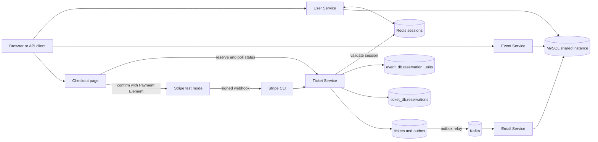

# Event Ticket Booking Platform

A local microservices project for exploring ticket inventory, concurrent reservations, external
payments, and reliable event delivery. MySQL is the source of truth for ticket inventory. Redis
stores login sessions; it does not coordinate reservations.

This is a development and learning project. Stripe is restricted to test mode and the Compose
configuration is not a production deployment.

## What it includes

- **User Service** — registration, login, Redis-backed sessions, and application-level encryption
  of user PII.
- **Event Service** — public catalog of upcoming events, prices, and available ticket counts.
- **Ticket Service** — time-limited inventory reservations, Stripe test-mode checkout, webhook
  settlement, purchase history, and a transactional outbox.
- **Email Service** — consumes `ticket.purchased` events from Kafka and records delivery status.
- **Reservation load simulator** — sends 10,000 concurrent reservation attempts through the real
  reservation handler and MySQL allocator, using fake sessions and a fake payment gateway.

## Architecture



### Reservation and payment flow

1. The authenticated client asks the Ticket Service to reserve units for an event.
2. In a short MySQL transaction, the service claims available unit rows with
   `SELECT ... FOR UPDATE SKIP LOCKED` and creates a pending reservation.
3. After committing that transaction, it creates a Stripe test-mode PaymentIntent and returns the
   client secret. Stripe network latency does not hold inventory row locks.
4. The browser confirms payment with Stripe.js. Stripe CLI forwards Stripe's signed webhook to the
   Ticket Service.
5. On a verified successful payment, one MySQL transaction marks the units sold, creates the
   ticket, marks the reservation purchased, and inserts the `ticket.purchased` outbox event.
6. The outbox relay publishes to Kafka. The Email Service consumes the event asynchronously.

If inventory is short, the service reclaims a bounded batch of expired reservations for that event
and retries the claim. Reservation status checks can also expire and release the requested hold.
There is no scheduled expiry worker. A successful payment received after its reservation expired
is refunded using an idempotency key.

## Services and local ports

| Component | Local address |
|---|---|
| User Service | `http://localhost:8081` |
| Event Service | `http://localhost:8082` |
| Ticket Service and checkout | `http://localhost:8083` |
| Email Service | `http://localhost:8084` |
| MySQL | `localhost:3306` |
| Redis host mapping | `localhost:6380` |
| Kafka | `localhost:9092` |

Inside Compose, services connect to Redis at `redis:6379`. The host port is `6380` to avoid
conflicting with another local Redis installation. For Go services run directly on the host, set
`REDIS_ADDR=localhost:6380`.

## Getting started

### Requirements

- Docker Desktop with Docker Compose v2
- Go 1.25+ and `make` for local commands
- Stripe CLI for local webhook forwarding
- `jq` for the sample shell commands below

### Configure secrets

Copy the example environment file and generate an application encryption key:

```bash
cp .env.example .env
openssl rand -base64 32
```

Put the generated value in `.env` as `ENCRYPTION_KEY`. Then add Stripe **test-mode** keys:

- `STRIPE_SECRET_KEY` starts with `sk_test_`
- `STRIPE_PUBLISHABLE_KEY` starts with `pk_test_`
- `STRIPE_WEBHOOK_SECRET` starts with `whsec_`

The service rejects live Stripe keys. Keep `.env` private and out of version control.

Authenticate the Stripe CLI if needed, then start its listener in a terminal:

```bash
stripe login
stripe listen --events payment_intent.succeeded,payment_intent.payment_failed,payment_intent.canceled \
  --forward-to http://localhost:8083/api/v1/payments/stripe/webhook
```

Copy the `whsec_...` value printed by `stripe listen` into `.env` as `STRIPE_WEBHOOK_SECRET` and
leave the listener running. The Ticket Service requires this value at startup.

### Start the stack

In another terminal, from the repository root:

```bash
docker compose up -d --build
docker compose ps
```

Wait until the services report healthy. If you change `.env` after startup, recreate the affected
service so it receives the updated value. For example:

```bash
docker compose up -d --force-recreate ticket-service
```

### Existing MySQL volumes

A fresh database created from `scripts/db/init.sql` already has the current schema. An older
volume may need these one-time migrations, in order:

```bash
make migrate-outbox             # if ticket_db.outbox_events is missing
make migrate-reservation-units  # if migration 004 has not been applied
make migrate-stripe-checkout    # after migration 004, if migration 005 has not been applied
```

Migration 005 alters existing tables and is not a repeatable migration. Do not run it if the
checkout columns and `ticket_db.reservations` table already exist.

### Add sample events

```bash
make seed
curl -sS http://localhost:8082/api/v1/events | jq
```

The seed command creates six future-dated sample events. It clears local `event_db.events`,
`event_db.reservation_units`, and `ticket_db.reservations` first, so use it for development data.
If the event API returns an empty list, seed fresh events and try again.

### Complete a checkout

There is no seeded admin account or registration web page. Register an account through the User
Service API, then log in:

```bash
curl -sS -X POST http://localhost:8081/api/v1/users/register \
  -H "Content-Type: application/json" \
  -d '{"name":"Jane Doe","email":"jane@example.com","password":"secure123"}' | jq

TOKEN=$(curl -sS -X POST http://localhost:8081/api/v1/users/login \
  -H "Content-Type: application/json" \
  -d '{"email":"jane@example.com","password":"secure123"}' | jq -r '.token')
```

Open [http://localhost:8083/checkout](http://localhost:8083/checkout), paste the login token, and
choose an upcoming event and quantity. For a successful Stripe test payment, use card
`4242 4242 4242 4242`, any future expiry date, and any three-digit CVC. See the
[Stripe test card guide](https://docs.stripe.com/testing) for declined-card and authentication
scenarios.

The checkout page shows a booking reference after the webhook settles the reservation. Test mode
does not make a real charge.

## Checking reservations without the UI

Create a reservation through the API:

```bash
curl -sS -X POST http://localhost:8083/api/v1/tickets/reservations \
  -H "Authorization: Bearer $TOKEN" \
  -H "Content-Type: application/json" \
  -d '{"event_id":1,"quantity":1}' | jq
```

The response contains a `reservation_id`, a `payment_intent_client_secret`, amount, currency, and
expiry. To check a reservation you own, use its ID and the same bearer token:

```bash
curl -sS "http://localhost:8083/api/v1/tickets/reservations/$RESERVATION_ID" \
  -H "Authorization: Bearer $TOKEN" | jq '{status, booking_ref}'
```

Statuses include `pending_payment`, `purchased`, `expired`, `cancelled`, and
`payment_setup_failed`. A booking reference appears after successful settlement.

### Complete a test payment without the browser

This test uses Stripe's test API with your `sk_test_...` key. Keep `stripe listen` running in a
separate terminal. It bypasses Stripe.js, so it verifies the PaymentIntent and webhook path, not
the browser Payment Element.

Load the test key from `.env`, then create a reservation and keep its identifiers in shell
variables so the client secret is not printed:

```bash
set -a
source .env
set +a

RESPONSE=$(curl -fsS -X POST http://localhost:8083/api/v1/tickets/reservations \
  -H "Authorization: Bearer $TOKEN" \
  -H "Content-Type: application/json" \
  -d '{"event_id":1,"quantity":1}')
RESERVATION_ID=$(printf '%s' "$RESPONSE" | jq -r '.reservation_id')
CLIENT_SECRET=$(printf '%s' "$RESPONSE" | jq -r '.payment_intent_client_secret')
PAYMENT_INTENT_ID=${CLIENT_SECRET%%_secret_*}
```

Confirm that PaymentIntent with a Stripe test payment method, then poll the reservation endpoint:

```bash
curl -fsS -X POST "https://api.stripe.com/v1/payment_intents/$PAYMENT_INTENT_ID/confirm" \
  -u "$STRIPE_SECRET_KEY:" \
  -d payment_method=pm_card_visa | jq '{id, status}'

curl -fsS "http://localhost:8083/api/v1/tickets/reservations/$RESERVATION_ID" \
  -H "Authorization: Bearer $TOKEN" | jq '{status, booking_ref}'
```

The reservation should reach `purchased` after the forwarded webhook is processed. This is a
test-mode API check; never use a live secret key for it. Stripe's [PaymentIntent confirmation
API](https://docs.stripe.com/api/payment_intents/confirm) and
[automated-testing guide](https://docs.stripe.com/automated-testing) describe the test flow.

## Reservation load simulation

```bash
make simulate-reservations
```

The command launches 10,000 synchronized clients against a local HTTP server using the same
reservation handler and service code. It uses actual local Redis authentication middleware and
MySQL unit allocation, but a fake payment gateway. It creates a temporary event with 500 units and
synthetic Redis sessions; it does not call Stripe, create user accounts, or alter seeded events.
The runner reports HTTP outcomes, latency percentiles, and database invariants, then removes its
temporary event and sessions.

Defaults cap the load generator at 1,000 HTTP connections and the simulation's MySQL pool at 100
connections. For example, one local run completed 10,000 requests with 500 reservations, 9,500
conflicts, and no 5xx responses. This is a local reservation-concurrency check, not a benchmark of
Stripe or a production-capacity claim. It does not confirm payments or test webhook settlement.

## API reference

All JSON endpoints use the `/api/v1` prefix. Protected routes require
`Authorization: Bearer <login-token>`.

### User Service (`:8081`)

| Method | Path | Auth | Purpose |
|---|---|---|---|
| `POST` | `/api/v1/users/register` | — | Create an account |
| `POST` | `/api/v1/users/login` | — | Create a session and return its bearer token |
| `POST` | `/api/v1/users/logout` | Bearer | Revoke the current session |
| `POST` | `/api/v1/users/delete` | Bearer | Anonymize account PII; preserve ticket records |
| `GET` | `/api/v1/users/me` | Bearer | Get the current user's profile |

Registration and login are rate limited per IP.

### Event Service (`:8082`)

| Method | Path | Auth | Purpose |
|---|---|---|---|
| `GET` | `/api/v1/events?page=1&per_page=20` | — | List upcoming events and available counts |
| `GET` | `/api/v1/events/{id}` | — | Get event details, price, and availability |

### Ticket Service (`:8083`)

| Method | Path | Auth | Purpose |
|---|---|---|---|
| `GET` | `/checkout` | — | Local Stripe test-mode checkout page |
| `GET` | `/api/v1/payments/config` | — | Return the Stripe publishable key for the page |
| `POST` | `/api/v1/tickets/reservations` | Bearer | Hold units and create a PaymentIntent |
| `GET` | `/api/v1/tickets/reservations/{id}` | Bearer | Get the owner's reservation status and booking reference |
| `GET` | `/api/v1/tickets` | Bearer | Get paginated purchase history |
| `POST` | `/api/v1/payments/stripe/webhook` | Stripe signature | Process signed PaymentIntent events |
| `POST` | `/api/v1/tickets/purchase` | Bearer | Compatibility alias; starts a reservation checkout |

`POST /reservations` returns `201 Created` when a hold and PaymentIntent are ready; it does not
mean a ticket is already purchased. The ticket is created only after webhook settlement.

### Common response codes

| Code | Meaning |
|---|---|
| `201` | Reservation created; payment is still pending |
| `400` | Invalid body, quantity, or event state |
| `401` | Missing, invalid, or expired bearer token |
| `404` | Event or reservation not found |
| `409` | Insufficient available inventory; retry only with bounded backoff |
| `500` | Internal or payment-provider failure |

## Development commands

| Command | Purpose |
|---|---|
| `make up` | Build and start the Compose stack |
| `make down` | Stop the stack **and delete Compose volumes**, including local MySQL data |
| `make seed` | Reset local event/reservation data and add sample events |
| `make simulate-reservations` | Run the 10,000-client reservation simulation |
| `make test-unit` | Run Go unit tests |
| `make test-integration` | Run integration-tagged Go tests |
| `make test-e2e` | Run the E2E-tagged Go tests |

Tests and the load simulation are separate commands. The load simulation uses real local MySQL
and Redis but a fake payment gateway; it is not an automated regression test for Stripe webhooks.

## Known limitations

- Inventory, reservations, tickets, and outbox records rely on one shared MySQL instance for
  cross-schema transactions. Splitting these databases across servers requires a saga or a new
  ownership boundary.
- Expired reservations are reclaimed on demand; there is no scheduled sweeper or virtual waiting
  room/admission controller.
- Stripe integration accepts test keys only. Production key management, reconciliation,
  disputes, and broader payment-method support are outside this project.
- The Event Service and Ticket Service access shared MySQL schemas directly in a few places.
- Outbox delivery is at least once, so consumers must tolerate duplicate events. Email retry-count
  persistence and concurrent duplicate-delivery handling have known gaps.
- The local load simulation validates reservation invariants on this machine; it does not establish
  production throughput or latency.

## Troubleshooting

- **`localhost:8081/` returns 404** — the service exposes API routes, not a homepage. Use
  `/api/v1/users/register` or `/api/v1/users/login` with `POST`.
- **No events are listed** — run `make seed`; it resets local event and reservation data.
- **“Event has already taken place”** — choose an event returned by the upcoming-events API.
- **Stripe webhook does not settle a reservation** — keep `stripe listen` running, confirm its
  current `whsec_...` is in `.env`, and recreate `ticket-service` after changing that value.
- **User or Email Service exits during startup** — `ENCRYPTION_KEY` must be valid base64 for 32
  bytes. Generate one with `openssl rand -base64 32`.
- **Host Redis port conflict** — Compose publishes Redis on `6380`; application containers still
  use `redis:6379` internally.
- **Inspect service logs** — `docker compose logs -f ticket-service` (replace the service name as
  needed).

## Project structure

```text
services/
  user/       registration, login, sessions, encrypted PII
  event/      public event catalog
  ticket/     reservations, Stripe, tickets, outbox, load simulator
  email/      Kafka consumer and email delivery status
  shared/     middleware, crypto, and Kafka helpers
scripts/
  db/         database initialization and migrations
  seed/       local sample events and reservation units
  kafka/      topic initialization
wiki/         project architecture and implementation notes
specs/        feature specification, plan, contracts, and data model
```
