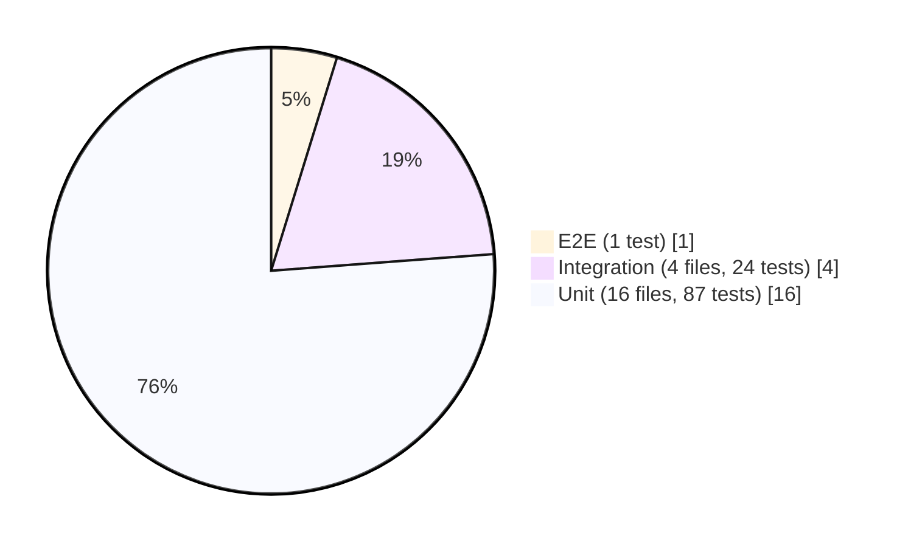

# Testing Strategy

## Overview

Testing spans unit, integration, end-to-end, and an explicit local burst simulation. Many tests use embedded or mocked dependencies; the burst simulation exercises the real reservation handler and MySQL unit allocator, but it is a manual load tool rather than an automated regression test. Testing is a MUST principle under the [[constitution]] (Principle IV: Test-Driven Development).

## Test Pyramid



Test counts and coverage should be refreshed after the reservation-unit concurrency test is added.

### Unit Tests (87)
- **Scope**: Individual functions in isolation
- **Dependencies**: Mocked (mock repositories, mock providers)
- **Speed**: <1ms per test
- **Tools**: Go standard `testing` package, `testify/mock`
- **Example**: Test that `purchase()` correctly rejects when fewer reservation units than requested are available

### Integration Tests
- **Scope**: Full HTTP router with real middleware, mock repositories
- **Dependencies**: `miniredis` (embedded Redis), mock MySQL repos
- **Speed**: ~10-50ms per test
- **Example**: Full purchase flow through HTTP handler and persistent inventory transaction

### E2E Tests (1)
- **Scope**: Cross-service smoke test
- **Flow**: register → login → browse events → purchase
- **Purpose**: Validates that services integrate correctly end-to-end

## Zero External Dependencies at Test Time

All tests use:
- `miniredis` — embedded Go Redis server (no Docker Redis needed)
- Mock repositories — no MySQL connection needed
- Mock Kafka producers — no Kafka broker needed

This is critical: tests must be runnable in CI without infrastructure, and must complete in under 15 seconds to not slow down the development feedback loop.

## Inventory Concurrency

The former embedded-Redis lock contention checks were removed with the Redlock purchase path. Inventory allocation now relies on MySQL's `FOR UPDATE SKIP LOCKED` and the unit-pool transaction described in [[reservation-unit-pool]]. `make simulate-reservations` launches 10,000 local HTTP clients against a temporary 500-unit event, with fake Redis sessions and a fake payment gateway. It verifies that reserved unit rows match pending reservations and do not exceed capacity. This manual burst does not replace an automated regression test or a production-scale benchmark.

## Constitution Requirements

- "All core business logic MUST be covered by unit tests AND integration tests before deployment"
- "Minimum code coverage for core business logic: 80%"
- "Tests MUST be written before implementation (TDD: Red → Green → Refactor)"

## Coverage Gaps (Known)

- Kafka consumer integration is tested at the unit level (mock consumer), not with a real Kafka broker
- Cross-database read paths (Ticket → Event DB) tested via mock, not real MySQL
- Email provider integration tested with `LogProvider` only

## Running Tests

```bash
make test-unit          # 87 unit tests
make test-integration   # 24 integration tests
make test-e2e           # Cross-service smoke test
```

## Cross-references

- [[constitution]] — Principle IV (Test-Driven Development)
- [[reservation-unit-pool]] — transactional inventory concurrency design
- [[user-service]], [[event-service]], [[ticket-service]], [[email-service]] — each has its own test files
- [[sources/code-structure]] — test file locations
