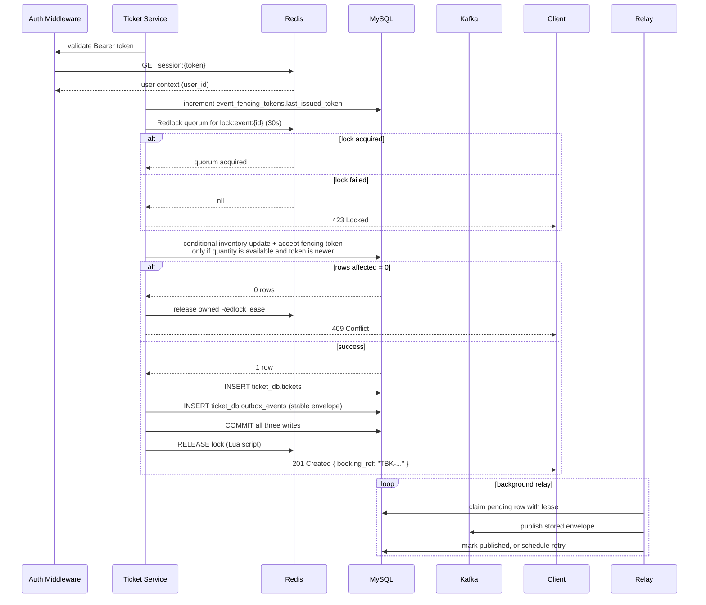

# Ticket Service

## Overview

The Ticket Service (`:8083`) owns the purchase flow — the critical path of the entire system. It uses [[redis]]-based distributed locking to serialize concurrent purchases and prevent double-selling. This is where the core architectural challenge lives.

## Responsibilities

- Purchase tickets with a five-master Redlock lease (per-event lock)
- Allocate a monotonic MySQL fencing token before lock acquisition and enforce it in the inventory update
- Inventory decrement, ticket insert, and outbox insert commit in one MySQL transaction
- Generate unique booking references (`TBK-{8 alphanumeric}`)
- Relay committed `ticket.purchased` outbox records to [[kafka]] with retry
- Purchase history retrieval with nested event details and pagination

## Interfaces

### REST API

| Method | Path | Auth | Description |
|--------|------|------|-------------|
| `POST` | `/api/v1/tickets/purchase` | Bearer | Purchase tickets. Body: `{"event_id": 1, "quantity": 2}` |
| `GET` | `/api/v1/tickets` | Bearer | Purchase history with nested event details |

### HTTP Status Codes (Purchase)

| Code | Meaning |
|------|---------|
| `201` | Purchase confirmed |
| `400` | Invalid input |
| `401` | Missing/expired session |
| `409` | Sold out or insufficient tickets |
| `423` | Lock contention — retry with backoff |

### Kafka

Writes a stable `ticket.purchased` event envelope, including `event_id` and `correlation_id`, to the outbox in the booking transaction. A background relay publishes it to Kafka.

## Purchase Flow (Detailed)

## Data Model

Database: `ticket_db`. Tables: `tickets`, `outbox_events`.

| Column | Type | Notes |
|--------|------|-------|
| `id` | BIGINT UNSIGNED | PK, AUTO_INCREMENT |
| `booking_ref` | CHAR(12) | UNIQUE, format: `TBK-{8 alphanumeric}` |
| `user_id` | BIGINT UNSIGNED | FK → user_db.users.id |
| `event_id` | BIGINT UNSIGNED | FK → event_db.events.id |
| `quantity` | INT UNSIGNED | > 0 |
| `status` | ENUM('confirmed', 'cancelled') | Default 'confirmed' |
| `created_at` | TIMESTAMP | |

Full schema: [data-model.md](../specs/001-event-ticket-booking/data-model.md#ticket-service-database-ticket_db)

## Key Decisions

- **Redlock plus database fencing** — Redlock coordinates leases across five masters; MySQL issues monotonic per-event tokens and rejects older tokens after a newer one is accepted. See [[distributed-locking]].
- **Atomic SQL UPDATE, not SELECT-then-UPDATE** — the `WHERE remaining_count >= ?` clause prevents race conditions at the database level as a backstop to the distributed lock.
- **Lock-per-event, not lock-per-ticket** — locking at the event granularity is sufficient for ticket inventory. Per-ticket locking would add complexity with no benefit.
- **Transactional outbox** — Kafka is published asynchronously from a durable row committed with the booking. The relay retries failures; a crash after Kafka acknowledgment but before marking delivery can publish a duplicate, so consumers must be idempotent.

## Known Technical Debt

- **Shared-instance transaction boundary**: inventory is in `event_db`, while tickets and the outbox are in `ticket_db`. The transaction is atomic because the current Compose setup places both schemas on one MySQL server. Moving them to separate MySQL instances requires a saga/reservation workflow or a different ownership boundary.
- **Cross-database read**: Ticket Service reads `event_db.events` directly for availability checks. Tagged `TODO(v2)` — future iteration should use Event Service API calls.
- **Lock granularity**: Lock-per-event could become a bottleneck if a single event experiences extreme demand. Sharded locks could be introduced if needed.

## Cross-references

- [[distributed-locking]] — the locking strategy
- [[redis]] — lock store and session validation
- [[kafka]] — `ticket.purchased` topic
- [[kafka-producer]] — code walkthrough of the `TicketEventPublisher`
- [[email-service]] — consumer of purchase events
- [[event-service]] — event data for purchase validation
- [[mysql]] — ticket_db and cross-database reads
- [[constitution]] — Principle II (Concurrency Management)
- [[trade-offs]] — v1 scope decisions affecting purchase flow
- [[sources/specs]] — traceability to spec requirements
- [[sources/code-structure]] — source location: `services/ticket/`
